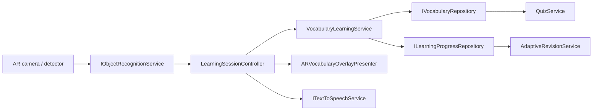

# AI-AR Language Learning MVP Architecture

This Unity project is organized as a small production-style architecture for the project synopsis:
AI-powered AR vocabulary learning with object recognition, multilingual translations, TTS, progress tracking, quizzes, retention analysis, and adaptive revision.

## MVP Goal

The first working MVP should prove the full learning loop with a controlled vocabulary:

1. Recognize or simulate a common object label.
2. Match that label to the local vocabulary catalog.
3. Display the selected language word in AR.
4. Play pronunciation through TTS.
5. Record views, pronunciation attempts, and quiz outcomes.
6. Recommend weak or unseen words for revision.

The current vocabulary catalog contains 32 common objects across English, Hindi, Malayalam, and French.

## Folder Layout

`Assets/_Project/LanguageLearning/Domain`
: Pure C# entities and value objects. No Unity dependency.

`Assets/_Project/LanguageLearning/Application`
: Use cases, ports, quiz generation, object label matching, progress recording, retention summaries, and adaptive revision.

`Assets/_Project/LanguageLearning/Unity`
: Unity adapters for Resources JSON loading, PlayerPrefs persistence, Android TTS, mock recognition, bootstrap, and AR UI presentation.

`Assets/_Project/LanguageLearning/Content/Resources/Vocabulary/vocabulary_catalog.json`
: MVP word catalog. Add words here first; avoid hardcoding vocabulary in scenes.

`Assets/_Project/LanguageLearning/Tests/EditMode`
: EditMode tests for matching, quiz generation, progress, and adaptive recommendations.

## Assemblies

`AIAR.LanguageLearning.Domain`
: Portable learning model. Can later move into a package or backend shared library.

`AIAR.LanguageLearning.Application`
: Testable business logic. Depends only on Domain.

`AIAR.LanguageLearning.Unity`
: Unity-specific implementation. Depends on Domain, Application, and TextMeshPro.

This keeps AR Foundation, Android, PlayerPrefs, and UI details outside the learning logic.

## Runtime Flow

## Scene Wiring

Create a scene object named `LanguageLearning`.

Add these components:

- `LanguageLearningCompositionRoot`
- `ResourcesVocabularyRepository`
- `MockObjectRecognitionService` for the MVP demo, later replaced by a Sentis/TFLite implementation.
- `AndroidTextToSpeechService`
- `LearningSessionController`

Assign references in `LanguageLearningCompositionRoot`:

- Vocabulary Repository: the `ResourcesVocabularyRepository` on the same object.
- Object Recognition Service: `MockObjectRecognitionService`.
- Text To Speech Service: `AndroidTextToSpeechService`.

Connect `LearningSessionController.onVocabularyDetected` to `ARVocabularyOverlayPresenter.ShowVocabulary`.
Connect a pronunciation button to `LearningSessionController.SpeakCurrentWord`.

## Scaling Path

Object recognition:
Implement `IObjectRecognitionService` with Unity Sentis or TensorFlow Lite. Keep model labels in English and use `recognitionLabels` in the JSON catalog for aliases.

Vocabulary:
Continue using the JSON schema for the MVP. When the word list becomes large, replace `ResourcesVocabularyRepository` with Addressables, SQLite, or a remote synced repository while keeping the same `IVocabularyRepository` port.

Progress:
`PlayerPrefsProgressRepository` is acceptable for MVP. For multi-user, sync, or analytics dashboards, replace it with SQLite or a cloud-backed repository through `ILearningProgressRepository`.

TTS:
`AndroidTextToSpeechService` is the mobile adapter. For pronunciation scoring later, add a separate speech-recognition port rather than mixing assessment into TTS.

Adaptive learning:
`AdaptiveRevisionService` currently ranks unseen, low-accuracy, low-mastery, and stale words. The scoring can evolve without changing AR presentation code.

Retention analysis:
`RetentionAnalysisService` converts raw word progress into total words, seen words, mastered words, struggling words, average mastery, and retention rate for the result-analysis section of the project.

## Font Note

Hindi and Malayalam require fonts with Devanagari and Malayalam glyph coverage. Use a TextMeshPro font asset based on a font family such as Noto Sans Devanagari and Noto Sans Malayalam, then assign it to the AR overlay text components.

## MVP Acceptance Checklist

- Catalog loads all MVP words without scene-specific code.
- Mock detector cycles through recognizable labels.
- AR overlay shows translated word, English source word, phonetic hint, and language name.
- Pronunciation button calls TTS and records an attempt.
- Quiz service can generate multiple-choice questions from the catalog.
- Adaptive revision returns unseen and weak words first.
- A real detector can replace `MockObjectRecognitionService` without changing learning logic.
