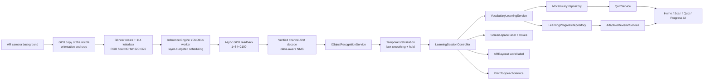

# AI-AR Language Learning MVP Architecture

This Unity project is organized as a small production-style architecture for the project synopsis:
AI-powered AR vocabulary learning with object recognition, multilingual translations, TTS, progress tracking, quizzes, retention analysis, and adaptive revision.

## MVP Goal

The first working MVP should prove the full learning loop with a controlled vocabulary:

1. Recognize or simulate a common object label.
2. Match that label to the local vocabulary catalog.
3. Display the selected language word in AR.
4. Play pronunciation through TTS.
5. Record views, pronunciation attempts, and quiz outcomes.
6. Recommend weak or unseen words for revision.

The current vocabulary catalog contains 32 common objects across English, Hindi, Malayalam, and French.

## Folder Layout

`Assets/_Project/LanguageLearning/Domain`
: Pure C# entities and value objects. No Unity dependency.

`Assets/_Project/LanguageLearning/Application`
: Use cases, ports, quiz generation, object label matching, progress recording, retention summaries, and adaptive revision.

`Assets/_Project/LanguageLearning/Unity`
: Unity adapters for Resources JSON loading, PlayerPrefs persistence, asynchronous Android TTS, Unity Inference Engine recognition, bootstrap, AR placement, and the learner-facing UI.

`Assets/_Project/LanguageLearning/ObjectDetection`
: Reproducibly exported YOLO11n ONNX, exact preprocessing/postprocessing metadata, COCO labels, and the golden validation image.

`Assets/_Project/LanguageLearning/Content/Resources/Vocabulary/vocabulary_catalog.json`
: MVP word catalog. Add words here first; avoid hardcoding vocabulary in scenes.

`Assets/_Project/LanguageLearning/Tests/EditMode`
: EditMode tests for matching, quiz generation, progress, and adaptive recommendations.

## Assemblies

`AIAR.LanguageLearning.Domain`
: Portable learning model. Can later move into a package or backend shared library.

`AIAR.LanguageLearning.Application`
: Testable business logic. Depends only on Domain.

`AIAR.LanguageLearning.Unity`
: Unity-specific implementation. Depends on Domain, Application, and TextMeshPro.

This keeps AR Foundation, Android, PlayerPrefs, and UI details outside the learning logic.

## Runtime Flow

## Scene Wiring

`Assets/Scenes/Main.unity` contains the AR Session, XR Origin, camera manager, runtime composition root,
YOLO11n detector, vocabulary repository, TTS adapter, learning session, and pooled vocabulary overlay.
`LearningSessionController` also repairs/creates `LearningMvpController` and
`ARWorldVocabularyPresenter` at startup so stale scene serialization cannot remove the learner flow.

The setup command `AI-AR Language Learning > Setup Main Scene` rebuilds the wiring deterministically.
It requires the exact `yolo11n_320.onnx` asset and fails loudly if the verified model or its 80 COCO
labels are absent. There is no mock or silent detector fallback in the production scene.

The Home screen is deliberately non-AR. Selecting Scan requests Android camera permission, verifies
AR Foundation availability, enables the AR session/camera/background, waits for initialization or
tracking, and only then starts recognition. Back, Quiz, and Progress stop recognition and disable
the camera path. This avoids launching XR subsystems before the learner requests a camera feature.

## Runtime Stability Rules

- Detection never reads the full camera image back to the CPU. AR Foundation's background material
  renders a reusable, display-oriented GPU frame, keeping preview rendering independent from inference.
- Only one preprocessing, inference, or readback operation may be in flight; newer camera frames are intentionally dropped.
- The YOLO graph is scheduled incrementally across rendered frames so inference does not monopolize one frame.
- Output is read back asynchronously; no blocking GPU download occurs in the camera callback.
- Scan selects a camera configuration near 1280x720 at 30 FPS when the device exposes one.
- The model consumes the exact visible camera crop. Reversing the deterministic letterbox therefore
  produces normalized screen coordinates without a fragile device-orientation approximation.
- The first valid prediction is shown immediately; brief detector gaps are held for 2 seconds and box/confidence values are smoothed.
- Bounding-box GameObjects are pooled and reused instead of instantiated for every inference result.
- Object views have a 12-second persistence cooldown, preventing frame rate from inflating learning progress.
- Detector state is surfaced as initializing, running, awaiting camera, degraded, faulted, or stopped.
- Verbose per-frame recognition logging is disabled in production builds.
- Android TTS queues the first utterance until the platform engine has initialized and verifies locale support.

## Scaling Path

Object recognition:
`RealtimeCocoObjectDetector` implements `IObjectRecognitionService`. Future model replacements must
provide a new explicit contract and decoder; output layouts are never guessed at runtime. Keep model
labels in English and use `recognitionLabels` in the JSON catalog for aliases.

Vocabulary:
Continue using the JSON schema for the MVP. When the word list becomes large, replace `ResourcesVocabularyRepository` with Addressables, SQLite, or a remote synced repository while keeping the same `IVocabularyRepository` port.

Progress:
`PlayerPrefsProgressRepository` is acceptable for MVP. For multi-user, sync, or analytics dashboards, replace it with SQLite or a cloud-backed repository through `ILearningProgressRepository`.

TTS:
`AndroidTextToSpeechService` is the mobile adapter. For pronunciation scoring later, add a separate speech-recognition port rather than mixing assessment into TTS.

Adaptive learning:
`AdaptiveRevisionService` currently ranks unseen, low-accuracy, low-mastery, and stale words. The scoring can evolve without changing AR presentation code.

Retention analysis:
`RetentionAnalysisService` converts raw word progress into total words, seen words, mastered words, struggling words, average mastery, and retention rate for the result-analysis section of the project.

## Font Note

Hindi and Malayalam use pre-generated Noto Sans TextMeshPro assets under
`Content/Resources/Fonts/TMP`. The Latin asset contains persisted Devanagari and Malayalam fallback
references. Keeping these as imported assets, rather than transient runtime-generated font objects,
also keeps TextMesh Pro's Android pre-build scan deterministic.

## MVP Acceptance Checklist

- Catalog loads all MVP words without scene-specific code.
- The official YOLO11n COCO export imports with exact input `[1,3,320,320]` and output `[1,84,2100]`.
- The detector uses GPU display-oriented preprocessing, layer-budgeted inference, non-blocking readback, explicit decoding, class-aware NMS, and temporal stabilization.
- AR overlay shows translated word, English source word, phonetic hint, and language name.
- A world-space label is placed through AR raycasting when a plane/feature point is available.
- Scan always exposes English, Hindi, Malayalam, and French selectors plus Back and Speak controls.
- Speak calls TTS for the current detected word in the selected language and records an attempt.
- The learner can return Home from Scan, Quiz, and Progress.
- Quiz exposes all four languages, advances only after an answer, and does not repeat adjacent prompts.
- Quiz answers are persisted and immediately update mastery/accuracy.
- Progress shows explored, mastered, struggling, mastery, accuracy, time, and adaptive recommendations.
- EditMode tests cover business rules, scene wiring, letterbox inversion, channel-first decoding, NMS,
  catalog completeness, multilingual font atlases, the imported model contract, and a CPU inference smoke test.
