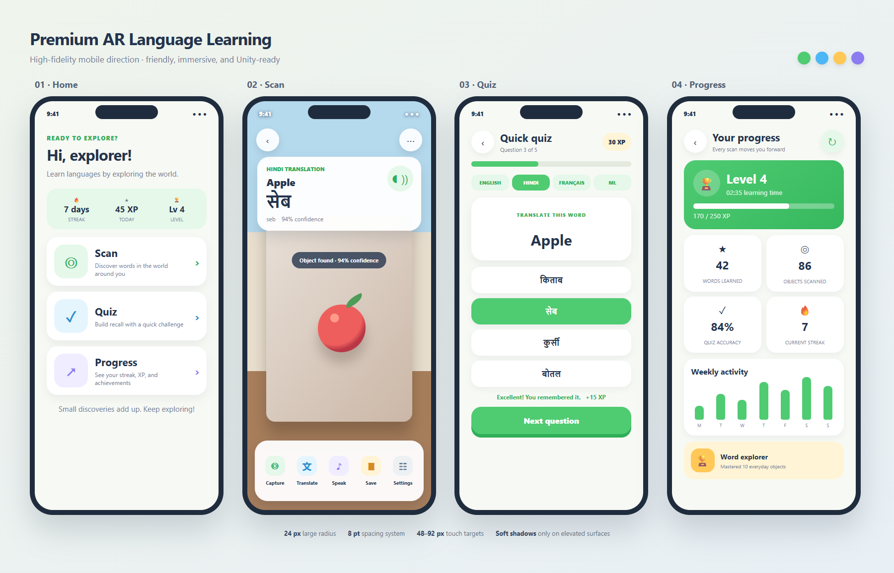

# AI-AR Language Learning System

An Android-first Unity application that turns real-world objects into interactive vocabulary lessons. The app uses augmented reality and on-device YOLO11 object detection to identify everyday objects, show multilingual labels, play pronunciation, generate quizzes, and track learning progress.



## Features

- Real-time AR object recognition for all 80 COCO object classes
- Vocabulary in English, Hindi, Malayalam, and French
- Screen-space detection boxes and AR world-space vocabulary labels
- Android text-to-speech pronunciation with locale checks
- Five-question multilingual quizzes with non-repeating questions
- Local progress, retention, streak, activity, and focused-time tracking
- Adaptive revision that prioritizes weak or overdue words
- Deferred camera and AR startup until the learner opens Scan
- GPU-based preprocessing, incremental inference, asynchronous readback, and temporal stabilization

## Technology

| Area | Technology |
| --- | --- |
| Engine | Unity `6000.4.11f1` |
| Rendering | Universal Render Pipeline `17.4.0` |
| AR | AR Foundation and ARCore `6.4.3` |
| Object detection | YOLO11n, Unity Inference Engine `2.6.1` |
| Input and interaction | Input System `1.19.0`, XR Interaction Toolkit `3.4.1` |
| UI and text | Unity UGUI, TextMesh Pro, UniText `1.0.0` |
| Persistence | Unity PlayerPrefs |
| Primary target | Android, IL2CPP, ARM64, minimum SDK 25 |

## Requirements

- Unity Hub
- Unity Editor `6000.4.11f1`
- Android Build Support, including the SDK, NDK, and OpenJDK modules
- An ARCore-supported Android device for camera and AR validation
- Camera permission and suitable Android TTS voice packs for the selected languages

Desktop tests can validate the learning logic, model contract, and scene wiring. Real camera detections, AR tracking, mobile GPU performance, world-label stability, and installed voices must be tested on a physical device.

## Getting Started

1. Clone the repository.
2. Add the project folder to Unity Hub and open it with Unity `6000.4.11f1`.
3. Wait for Unity to restore packages and finish importing assets.
4. Open `Assets/Scenes/Main.unity`.
5. Select **AI-AR Language Learning > Setup Main Scene** to rebuild and validate the scene wiring.
6. Run the EditMode test suite before creating a device build.

The setup command requires the verified `yolo11n_320.onnx` model and its aligned 80-class label files. It fails explicitly if required detector assets are missing.

## Build and Run on Android

1. Connect or prepare an ARCore-supported Android phone.
2. In Unity, select **AI-AR Language Learning > Build Android Debug APK**.
3. Install the generated APK from `Builds/Android/AIARLanguageLearning-debug.apk`.
4. Launch the app and grant camera permission when Scan is opened.
5. Point the camera at a supported everyday object, switch languages, and use **Speak** to hear its pronunciation.

The development build uses package ID `com.raihan.aiarlanguagelearning`. The camera and AR subsystems remain disabled on Home, Quiz, and Progress screens and start only when Scan is selected.

## Learning Flow

1. **Scan** recognizes an object and matches its English detector label to the vocabulary catalog.
2. The app displays English, Hindi, Malayalam, or French vocabulary and can play its pronunciation.
3. Each vocabulary item is recorded once per Scan session to avoid inflated progress from repeated frames.
4. **Quiz** tests recall with a varied five-question sequence.
5. **Progress** summarizes learned words, quiz accuracy, retention, streaks, and recent activity.
6. Adaptive revision gives weak, unassessed, or overdue learned words greater priority in later quizzes.

## Architecture

The project separates portable learning logic from Unity-specific infrastructure:

| Layer | Location | Responsibility |
| --- | --- | --- |
| Domain | `Assets/_Project/LanguageLearning/Domain` | Entities and value objects with no Unity dependency |
| Application | `Assets/_Project/LanguageLearning/Application` | Learning use cases, quizzes, matching, retention, and revision rules |
| Unity adapters | `Assets/_Project/LanguageLearning/Unity` | AR, inference, repositories, TTS, bootstrap, and presentation |
| Content | `Assets/_Project/LanguageLearning/Content` | Runtime vocabulary and font resources |
| Detector assets | `Assets/_Project/LanguageLearning/ObjectDetection` | ONNX model, metadata, labels, and validation image |
| Tests | `Assets/_Project/LanguageLearning/Tests/EditMode` | Architecture, learning-flow, scene, UI, and detector tests |

The runtime dependency direction is:

```text
Domain <- Application <- Unity
```

The main scene composes the AR session, XR origin, camera manager, object detector, repositories, TTS service, learning session, and learner-facing UI.

## Content and Model Configuration

The runtime vocabulary source is:

```text
Assets/_Project/LanguageLearning/Content/Resources/Vocabulary/vocabulary_catalog.json
```

Each entry contains a canonical detector label, optional recognition aliases, category information, and translations with pronunciation locales. Update this catalog instead of hardcoding vocabulary in scenes.

The bundled detector uses this fixed contract:

- Model: YOLO11n trained on COCO 80
- Input: RGB float tensor `[1, 3, 320, 320]`
- Resize: aspect-preserving letterbox with fill value 114
- Output: `[1, 84, 2100]`
- Post-processing: contract-specific decoding and class-aware non-maximum suppression

See the [object-detection README](Assets/_Project/LanguageLearning/ObjectDetection/README.md) for the model hash, export procedure, and validation details.

## Testing

Open Unity's Test Runner and run the **EditMode** suite. It covers:

- vocabulary matching and four-language catalog coverage;
- quiz generation, retention, progress, and adaptive revision;
- main-scene, UI, AR startup, and Android provider wiring;
- the YOLO input/output contract, CPU inference smoke test, decoder, and NMS;
- font assets and Indic-script shaping support;
- guards against missing scripts and invalid TextMesh Pro atlas references.

For device acceptance, verify camera permission, ARCore tracking, real detections, performance, TTS, language switching, quiz completion, persistence, and progress metrics on a supported Android phone.

## Project Documentation

- [Architecture](Assets/_Project/LanguageLearning/Documentation/Architecture.md)
- [Build and test checklist](Assets/_Project/LanguageLearning/Documentation/BuildAndTest.md)
- [Real-time object recognition](Assets/_Project/LanguageLearning/Documentation/RealObjectRecognition.md)
- [UI implementation guide](Assets/_Project/LanguageLearning/Documentation/UI/UI-Implementation-Guide.md)
- [UI design system](Assets/_Project/LanguageLearning/Documentation/UI/PremiumARLanguageLearning-DesignSystem.md)

## Current Status

The MVP source and Unity project wiring are in place. Desktop compilation and automated EditMode validation cover the software path, but a fresh Android build and a physical-device acceptance pass are still required for release validation.

## Licensing

Third-party packages and assets remain subject to their respective licenses. In particular, Ultralytics offers YOLO11 under AGPL-3.0 or an Enterprise license; confirm the appropriate licensing terms before distributing the application. This repository does not currently include a project-wide license file.
